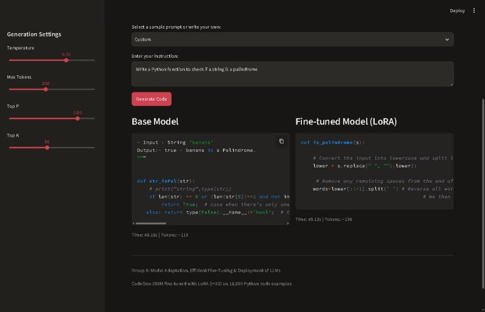
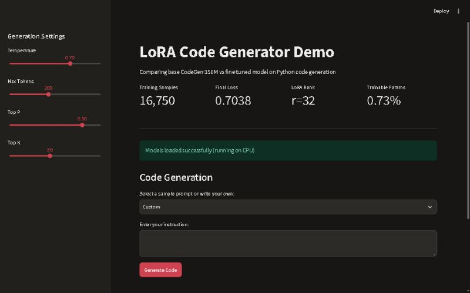

# LoRA Fine-Tuning of a Code Generation LLM

Parameter-efficient fine-tuning of Salesforce CodeGen-350M on Python instruction/code pairs with LoRA, and a Streamlit application that compares the base model and the fine-tuned model side by side on the same prompt.



## Summary

| | |
|---|---|
| Base model | `Salesforce/codegen-350M-mono` (causal language model, Python) |
| Method | LoRA with Hugging Face PEFT (no quantization; FP16 training) |
| Dataset | `iamtarun/python_code_instructions_18k_alpaca` |
| Training set | 16,750 examples (90/10 train/eval split, seed 42) |
| Trainable parameters | 2,621,440 of 359,333,888 (0.73%) |
| Final evaluation loss | 0.7038 |
| Adapter size | 10.5 MB |

The evaluation loss is the only metric recorded for this run (`models/lora_adapters/training_info.json`). No functional-correctness benchmark (HumanEval, pass@k) was run, so the comparison in the application is qualitative.

## Method

The base model is frozen and low-rank adapters are trained on the attention projection of every transformer block.

| LoRA setting | Value |
|---|---|
| Rank `r` | 32 |
| `lora_alpha` | 64 |
| Dropout | 0.05 |
| Target modules | `qkv_proj` |
| Bias | none |

| Training setting | Value |
|---|---|
| Epochs | 6 |
| Batch size | 4, gradient accumulation 4 (effective 16) |
| Learning rate | 2e-4, cosine schedule, 500 warm-up steps |
| Optimizer | AdamW, weight decay 0.01 |
| Max sequence length | 512 tokens |
| Model selection | lowest evaluation loss, evaluated every 200 steps |

Each example is formatted with an Alpaca-style template, which the application reuses at inference time:

```
### Instruction:
{instruction}

### Response:
{output}
```

## Repository structure

```
.
├── app.py                          Streamlit comparison application
├── requirements.txt
├── models/lora_adapters/           Trained LoRA adapter, tokenizer and training_info.json
├── training/Iora_finetuning.ipynb  Training notebook (written for Google Colab, GPU)
└── assets/                         Screenshots
```

## Running the application

```bash
git clone https://github.com/Symooomzip/lora-codegen-finetuning.git
cd lora-codegen-finetuning
python -m venv .venv
.venv\Scripts\activate            # Linux / macOS: source .venv/bin/activate
pip install -r requirements.txt
streamlit run app.py
```

The base model (about 800 MB) is downloaded from the Hugging Face Hub on first launch. The application runs on CPU; a GPU is used automatically when available. The pinned versions in `requirements.txt` are the ones the project was built with; it also runs on current releases of `transformers`, `peft` and `streamlit`.

The sidebar exposes the generation settings (temperature, max tokens, top-p, top-k). Both models receive the same prompt and the same settings, and the outputs are displayed next to each other with their generation time.



## Reproducing the training

Open `training/Iora_finetuning.ipynb` in Google Colab with a GPU runtime and run all cells. The notebook loads the dataset, applies the template, tokenizes, trains for 6 epochs and saves the adapter and `training_info.json` to `lora_adapters/`.

## Limitations

- Only the evaluation loss was measured. The quality of the generated code has not been benchmarked.
- CodeGen-350M is a small model; outputs can be incomplete or incorrect, with or without the adapter.
- The application is a local demonstration and is not deployed.

## Context

Academic group project (Group 6) for the course "Model Adaptation, Efficient Fine-Tuning and Deployment of LLMs", Master's in Data Science and Artificial Intelligence, Mundiapolis University, Casablanca.

## Contact

Mohammed Fakir — mr.fakir.mohammed@gmail.com — [github.com/Symooomzip](https://github.com/Symooomzip)
